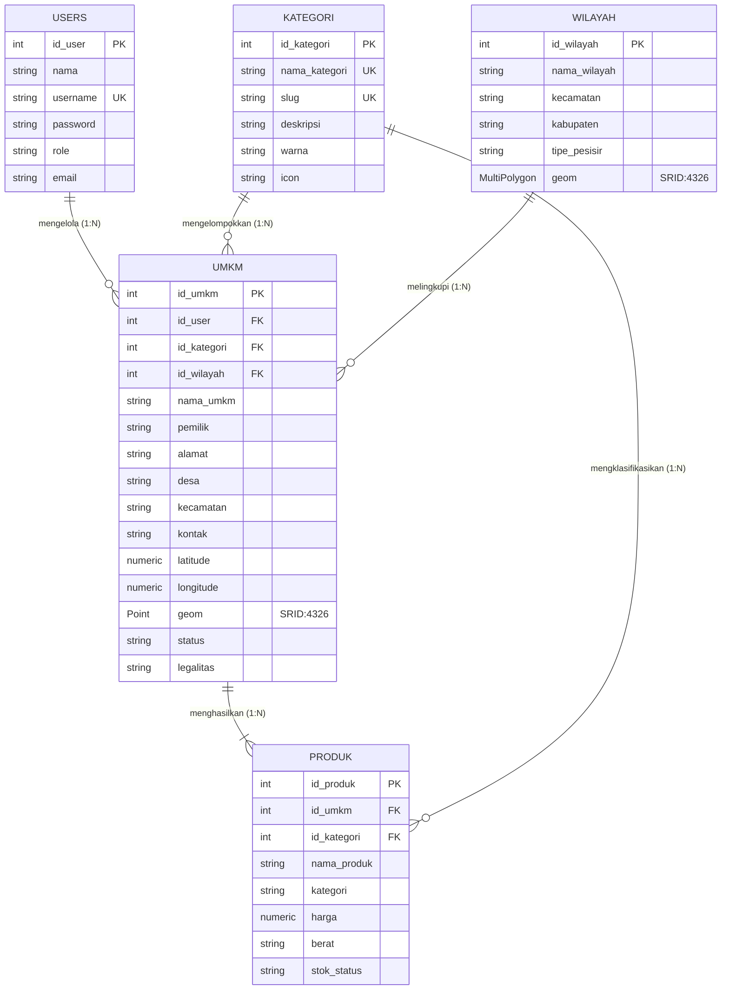
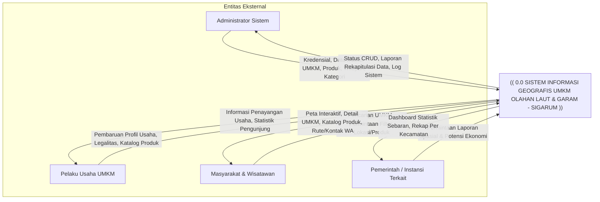
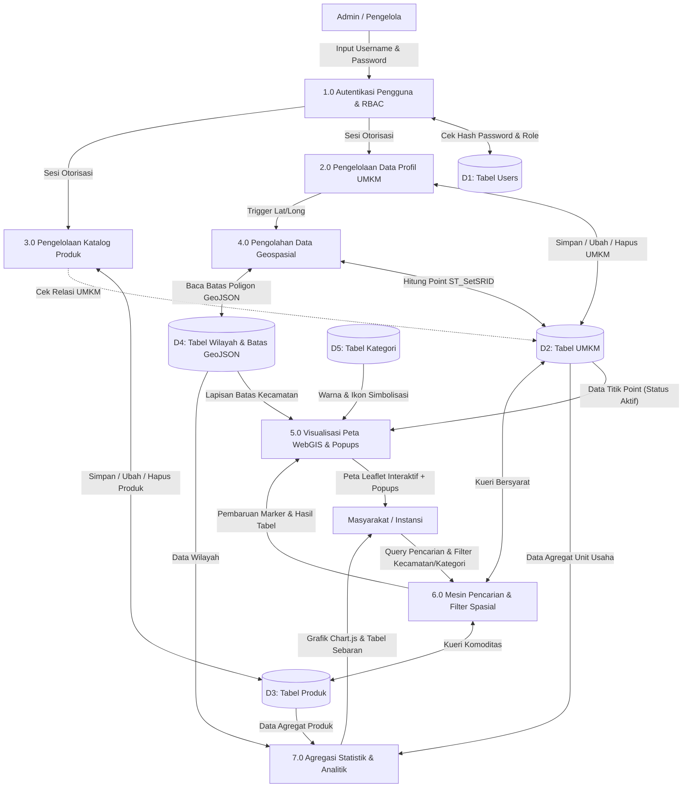

# DOKUMENTASI LENGKAP PERANCANGAN PROTOTYPE WEBGIS SIGARUM
## Sistem Informasi Geografis UMKM Olahan Laut dan Garam (Kabupaten Pamekasan)

> **Catatan Akademik & Status Proyek:**  
> Dokumen ini disusun sebagai artefak perancangan sistem informasi geografis komprehensif untuk tugas mata kuliah Sistem Informasi / Sistem Informasi Geografis. Seluruh data titik koordinat, entitas UMKM, produk, dan pemilik yang terdapat pada prototype ini berstatus **DATA DEMO / DATA PROTOTYPE (SIMULASI)** yang menggunakan konteks kewilayahan Kabupaten Pamekasan, Madura, Jawa Timur.

---

## DAFTAR ISI
1. [Identitas Proyek](#1-identitas-proyek)
2. [Latar Belakang & Urgensi](#2-latar-belakang--urgensi)
3. [Identifikasi Masalah](#3-identifikasi-masalah)
4. [Tujuan Sistem](#4-tujuan-sistem)
5. [Analisis Kebutuhan Sistem (Requirements Analysis)](#5-analisis-kebutuhan-sistem)
   - [5.1 Kebutuhan Fungsional (Functional Requirements)](#51-kebutuhan-fungsional)
   - [5.2 Kebutuhan Non-Fungsional (Non-Functional Requirements)](#52-kebutuhan-non-fungsional)
6. [Perancangan Basis Data (Database Design PostgreSQL + PostGIS)](#6-perancangan-basis-data)
   - [6.1 Struktur Tabel & Kamus Data](#61-struktur-tabel--kamus-data)
   - [6.2 Tipe Data Spasial & Geometri PostGIS](#62-tipe-data-spasial--geometri-postgis)
   - [6.3 Relasi Antar Tabel & Integritas Referensial](#63-relasi-antar-tabel)
7. [Entity Relationship Diagram (ERD)](#7-entity-relationship-diagram-erd)
8. [Data Flow Diagram (DFD) Level 0 (Context Diagram)](#8-dfd-level-0-context-diagram)
9. [Data Flow Diagram (DFD) Level 1](#9-dfd-level-1)
10. [Konsep Desain UI/UX & Design System](#10-konsep-desain-uiux--design-system)
11. [Fitur & Struktur Menu Sistem](#11-fitur--struktur-menu-sistem)
12. [Aturan Bisnis (Business Rules BR-01 s/d BR-15)](#12-aturan-bisnis-business-rules)
13. [Arsitektur Sistem & Alur Integrasi GIS](#13-arsitektur-sistem--alur-integrasi-gis)
14. [Data Dummy & Konteks Geospasial Kabupaten Pamekasan](#14-data-dummy--konteks-geospasial-pamekasan)
15. [Panduan Pengujian & Skenario Presentasi Mahasiswa](#15-panduan-pengujian--skenario-presentasi)
16. [Rencana Pengembangan Sistem Selanjutnya (Roadmap Phase 2)](#16-rencana-pengembangan-selanjutnya)

---

## 1. IDENTITAS PROYEK

- **Nama Aplikasi:** SIGARUM
- **Kepanjangan:** Sistem Informasi Geografis UMKM Olahan Laut dan Garam
- **Tagline:** *"Pemetaan UMKM, Potensi Lokal, dan Informasi Ekonomi Berbasis Lokasi."*
- **Fokus Sistem:** Pemetaan persebaran spasial, profil usaha, komoditas unggulan, kontak pemasaran, dan agregasi statistik UMKM di sektor olahan laut (ikan kering, teri, kerupuk, terasi, petis, abon) dan sentra garam rakyat (garam konsumsi beryodium, garam kristal krosok, garam meja, garam spa, garam pakan).
- **Target Pengguna:**
  1. *Masyarakat & Wisatawan:* Mencari lokasi sentra UMKM dan produk khas pesisir.
  2. *Pelaku UMKM:* Memperkenalkan profil usaha, legalitas izin edar, dan katalog komoditas.
  3. *Admin/Pengelola Sistem:* Mengelola verifikasi data master UMKM, wilayah, dan produk.
  4. *Pemerintah / Instansi Terkait (Dinas Koperasi & UKM, Dinas Perikanan):* Memantau konsentrasi spasial dan kluster ekonomi wilayah sebagai dasar perumusan program bantuan dan pemberdayaan.

---

## 2. LATAR BELAKANG & URGENSI

Kabupaten Pamekasan yang terletak di Pulau Madura memiliki garis pantai panjang yang membentang dari pesisir selatan (Selat Madura: Pademawu, Tlanakan, Galis) hingga pesisir utara (Laut Jawa: Pasean, Batumarmar). Kondisi geografis ini menjadikan Pamekasan sebagai salah satu sentra garam rakyat terbesar di Indonesia sekaligus lumbung komoditas perikanan laut.

Namun, potensi ekonomi lokal yang melimpah ini belum diimbangi oleh ketersediaan sistem informasi geospasial terpadu. Banyak unit usaha mikro dan kecil masih beroperasi secara terisolasi tanpa titik lokasi digital yang terverifikasi. Konsumen luar daerah, pelaku industri makanan, dan wisatawan sering mengalami kesulitan dalam menemukan produsen langsung. Di sisi lain, instansi pemerintah membutuhkan visualisasi spasial yang akurat untuk mengidentifikasi wilayah sentra yang membutuhkan intervensi infrastruktur (seperti meja kristalisasi geomembran atau fasilitas higienitas pengeringan ikan).

Oleh karena itu, SIGARUM hadir sebagai solusi digital berbasis WebGIS yang menjembatani kebutuhan informasi spasial dan promosi ekonomi komoditas pesisir.

---

## 3. IDENTIFIKASI MASALAH

1. **Fragmentasi Data:** Data lokasi dan profil UMKM masih tersebar dalam format arsip konvensional dan belum terintegrasi secara digital.
2. **Ketiadaan Peta Tematik Khusus:** Belum tersedianya portal peta digital tematik yang mengkhususkan diri pada sektor maritim olahan laut dan garam.
3. **Kesulitan Penelusuran Berbasis Wilayah:** Masyarakat dan pembeli grosir sulit memfilter UMKM berdasarkan kedekatan kecamatan atau jenis produk spesifik.
4. **Minimnya Visualisasi Spasial untuk Pengambil Kebijakan:** Dinas terkait kesulitan melihat persebaran densitas UMKM antar-kecamatan secara spasial.
5. **Keterbatasan Media Promosi Digital UMKM:** Pelaku usaha tradisional belum memanfaatkan teknologi koordinat GIS dan katalog web untuk memperluas jangkauan pasar.

---

## 4. TUJUAN SISTEM

1. Memetakan koordinat geografis presisi seluruh UMKM olahan hasil laut dan garam dalam satu antarmuka peta interaktif.
2. Menyediakan direktori profil usaha yang memuat legalitas (NIB/P-IRT/Halal), kontak langsung WhatsApp, dan alamat fisik.
3. Menyajikan katalog komoditas produk lengkap dengan transparansi harga dan foto produk.
4. Mengimplementasikan filter spasial berlapis (berdasarkan nama, kecamatan, kategori, jenis produk, dan status operasional).
5. Menyediakan dashboard analitik statistik untuk visualisasi agregat per wilayah kecamatan.
6. Menyediakan antarmuka panel administrasi (CRUD) yang aman, responsif, dan menerapkan business rules geospasial secara ketat.

---

## 5. ANALISIS KEBUTUHAN SISTEM

### 5.1 Kebutuhan Fungsional (Functional Requirements)

| Kode Kebutuhan | Deskripsi Kebutuhan |
|---|---|
| **FR-01** | Sistem harus dapat menampilkan peta dasar OpenStreetMap, Carto Positron, dan Citra Satelit Esri menggunakan Leaflet.js. |
| **FR-02** | Sistem harus dapat memplot marker lokasi UMKM dengan simbolisasi visual berbeda antara kategori Olahan Laut (ikon ikan/biru) dan Garam (ikon kristal/emas). |
| **FR-03** | Sistem harus menampilkan popup informatif saat marker diklik (foto, nama UMKM, kategori, desa, kecamatan, produk unggulan, status, dan tombol detail). |
| **FR-04** | Sistem harus menyediakan fitur pencarian real-time (live search) berdasarkan nama UMKM, produk, atau nama desa. |
| **FR-05** | Sistem harus menyediakan filter multi-kriteria: Kecamatan, Kategori Usaha, Jenis Produk, dan Status Keaktifan. |
| **FR-06** | Sistem harus menampilkan poligon batas wilayah kecamatan pesisir Pamekasan dari berkas GeoJSON dengan fitur hover highlight dan klik-untuk-zoom. |
| **FR-07** | Sistem harus menyediakan halaman direktori data UMKM berbentuk tabel responsif dengan fitur pagination, pencarian, dan tautan aksi ke peta. |
| **FR-08** | Sistem harus menyediakan halaman detail UMKM lengkap dengan mini map interaktif, tombol salin koordinat, dan tautan langsung ke chat WhatsApp pemilik. |
| **FR-09** | Sistem harus menyediakan katalog produk dalam bentuk kartu visual yang menampilkan harga satuan, berat, foto, dan UMKM produsen. |
| **FR-10** | Sistem harus menyajikan dashboard analitik statistik dengan grafik donat dan diagram batang (Chart.js) untuk persebaran kategori dan kecamatan. |
| **FR-11** | Sistem harus memiliki modul autentikasi login pengelola dengan pemisahan peran (*Admin* dan *Pelaku UMKM*). |
| **FR-12** | Sistem harus menyediakan antarmuka CRUD (Create, Read, Update, Delete) data UMKM bagi administrator dengan validasi koordinat. |
| **FR-13** | Sistem harus menyediakan antarmuka CRUD data produk yang terasosiasi dengan UMKM dan validasi harga non-negatif. |
| **FR-14** | Sistem harus menyediakan manajemen master data kategori dan master data wilayah kecamatan. |
| **FR-15** | Sistem harus menyediakan tombol geolokasi (*Locate Me*) untuk mendeteksi posisi pengguna saat membuka WebGIS. |

### 5.2 Kebutuhan Non-Fungsional (Non-Functional Requirements)

- **Usability (Kemudahan Penggunaan):** Antarmuka menggunakan paradigma *Modern Minimalist GIS Dashboard*, navigasi intuitif, konsistensi palet warna laut (navy/sky) dan garam (amber/gold), serta informatif pada keadaan data kosong (*empty state*).
- **Responsiveness:** Tampilan web adaptif pada resolusi Desktop (Sidebar + Map), Tablet (Collapsible Sidebar), dan Smartphone (Bottom drawer / Mobile sheet).
- **Performance:** Waktu inisialisasi peta dan pemuatan GeoJSON di bawah 2 detik pada koneksi standar. Manipulasi filter pada *client-side* bersifat instan tanpa reload halaman penuh.
- **Reliability & Data Integrity:** Menerapkan *cascade delete* pada penghapusan UMKM terhadap produk terkait (BR-14) dan validasi format koordinat numerik (BR-12).
- **Security:** Hashing kata sandi pengguna menggunakan algoritma bcrypt (BR-15), pemisahan hak akses publik hanya-baca (BR-11), serta validasi input formulir.

---

## 6. PERANCANGAN BASIS DATA (DATABASE DESIGN)

Sistem dirancang menggunakan Relational Database Management System (RDBMS) **PostgreSQL 14+** dengan ekstensi spasial **PostGIS 3.0+**.

### 6.1 Struktur Tabel & Kamus Data

#### 1. Tabel `users`
Menyimpan kredensial dan hak akses akun.
- `id_user` (SERIAL, Primary Key): Pengenal unik akun.
- `nama` (VARCHAR(150), NOT NULL): Nama lengkap pengguna.
- `username` (VARCHAR(50), UNIQUE, NOT NULL): Nama akun login.
- `password` (VARCHAR(255), NOT NULL): Hash kata sandi terenkripsi bcrypt.
- `role` (VARCHAR(20), NOT NULL): Peran pengguna (`admin` / `umkm`).
- `email` (VARCHAR(100)): Alamat surel aktif.
- `created_at` (TIMESTAMP): Waktu registrasi akun.

#### 2. Tabel `kategori`
Menyimpan klasifikasi sektor usaha.
- `id_kategori` (SERIAL, Primary Key): Pengenal unik kategori.
- `nama_kategori` (VARCHAR(100), UNIQUE, NOT NULL): Nama kategori (`Olahan Laut`, `Garam`, dll).
- `slug` (VARCHAR(100), UNIQUE): Slug URL.
- `deskripsi` (TEXT): Deskripsi ruang lingkup kategori.
- `warna` (VARCHAR(10)): Kode warna HEX untuk simbolisasi peta.
- `icon` (VARCHAR(50)): Nama ikon identifikasi.

#### 3. Tabel `wilayah`
Menyimpan data wilayah administratif dan batas poligon spasial.
- `id_wilayah` (SERIAL, Primary Key): Pengenal wilayah.
- `nama_wilayah` (VARCHAR(100), NOT NULL): Nama wilayah.
- `kecamatan` (VARCHAR(100), NOT NULL): Nama kecamatan.
- `kabupaten` (VARCHAR(100), NOT NULL): Nama kabupaten (Default: `Pamekasan`).
- `tipe_pesisir` (VARCHAR(100)): Karakteristik kawasan pesisir.
- `geom` (GEOMETRY(MultiPolygon, 4326)): Batas wilayah poligon PostGIS dalam proyeksi WGS 84.

#### 4. Tabel `umkm`
Menyimpan profil UMKM dan titik koordinat geografis.
- `id_umkm` (SERIAL, Primary Key): Pengenal unik UMKM.
- `id_user` (INT, Foreign Key -> users.id_user): Akun pemilik (opsional).
- `id_kategori` (INT, Foreign Key -> kategori.id_kategori, NOT NULL).
- `id_wilayah` (INT, Foreign Key -> wilayah.id_wilayah).
- `nama_umkm` (VARCHAR(200), NOT NULL): Nama unit usaha.
- `pemilik` (VARCHAR(150), NOT NULL): Nama pemilik/penanggung jawab.
- `alamat` (TEXT, NOT NULL): Alamat jalan/dusun.
- `desa` (VARCHAR(100), NOT NULL): Nama desa.
- `kecamatan` (VARCHAR(100), NOT NULL): Nama kecamatan.
- `deskripsi` (TEXT): Profil deskriptif usaha.
- `kontak` (VARCHAR(50), NOT NULL): Nomor telepon/WhatsApp.
- `latitude` (NUMERIC(10, 7), NOT NULL): Derajat lintang (-90.0 s/d 90.0).
- `longitude` (NUMERIC(10, 7), NOT NULL): Derajat bujur (-180.0 s/d 180.0).
- `geom` (GEOMETRY(Point, 4326)): Titik spasial PostGIS hasil sinkronisasi trigger.
- `foto` (VARCHAR(255)): URL foto profil usaha.
- `status` (VARCHAR(20), NOT NULL, DEFAULT 'Aktif'): Status (`Aktif` / `Nonaktif`).
- `tahun_berdiri` (INT): Tahun mulai beroperasi.
- `legalitas` (VARCHAR(200)): Nomor izin (NIB, P-IRT, Halal).

#### 5. Tabel `produk`
Menyimpan katalog produk olahan dan garam.
- `id_produk` (SERIAL, Primary Key): Pengenal unik produk.
- `id_umkm` (INT, Foreign Key -> umkm.id_umkm ON DELETE CASCADE, NOT NULL).
- `id_kategori` (INT, Foreign Key -> kategori.id_kategori).
- `nama_produk` (VARCHAR(200), NOT NULL): Nama komoditas.
- `kategori` (VARCHAR(100), NOT NULL): Kategori produk.
- `harga` (NUMERIC(12, 2), NOT NULL, CHECK harga >= 0): Harga satuan.
- `berat` (VARCHAR(50)): Satuan berat / kemasan (misal: 250 gram, 50 kg).
- `deskripsi` (TEXT): Rincian bahan dan cara penyajian.
- `foto` (VARCHAR(255)): URL foto produk.
- `stok_status` (VARCHAR(50), DEFAULT 'Tersedia'): Ketersediaan barang.

---

## 7. ENTITY RELATIONSHIP DIAGRAM (ERD)

Berikut adalah diagram relasi entitas lengkap yang menggambarkan kardinalitas antar tabel dalam basis data SIGARUM:



### Penjelasan Kardinalitas Relasi:
1. **USERS ke UMKM (1:N):** Satu akun pengguna (khususnya admin atau pemilik usaha) dapat memiliki atau terhubung ke satu atau banyak entitas UMKM.
2. **KATEGORI ke UMKM (1:N):** Satu kategori (Olahan Laut atau Garam) menaungi banyak UMKM, namun setiap UMKM memiliki satu kategori utama (BR-03).
3. **WILAYAH ke UMKM (1:N):** Satu wilayah administratif kecamatan melingkupi banyak UMKM yang berada di dalam batas spasial poligonnya.
4. **UMKM ke PRODUK (1:N):** Satu UMKM dapat memproduksi dan menjual banyak varian produk (BR-05), namun setiap produk hanya terdaftar pada satu UMKM produsen (BR-06).

---

## 8. DFD LEVEL 0 (CONTEXT DIAGRAM)

Diagram Konteks menggambarkan batasan sistem WebGIS SIGARUM terhadap empat entitas eksternal:



---

## 9. DFD LEVEL 1

Diagram DFD Level 1 merinci aliran data ke dalam 7 proses utama sistem:



---

## 10. KONSEP DESAIN UI/UX & DESIGN SYSTEM

Desain antarmuka SIGARUM mengusung tema **Modern + Minimalist + Professional + GIS Dashboard** dengan panduan visual sebagai berikut:

### 10.1 Skema Warna (Color Palette)
- **Primary Ocean (`#0284c7` - `#0369a1`):** Merepresentasikan potensi maritim, perikanan laut, dan profesionalisme sistem geospasial. Digunakan pada header, marker olahan laut, dan tombol aksi utama.
- **Salt Gold / Amber (`#d97706` - `#f59e0b`):** Merepresentasikan kristal garam rakyat, kemakmuran pesisir, dan aksen pembeda untuk sentra tambak garam.
- **Emerald Green (`#059669` / `#10b981`):** Status verifikasi aktif, stok tersedia, dan tombol aksi WhatsApp.
- **Slate Navy (`#0f172a` - `#1e293b`):** Teks utama, sidebar admin, dan footer kontras tinggi.
- **Clean Slate Background (`#f8fafc`):** Memberikan kenyamanan visual saat membaca data spasial.

### 10.2 Tipografi & Hierarki
- Font keluarga **Plus Jakarta Sans**: Tipografi geometris modern yang sangat jelas terbaca pada label peta, angka koordinat, dan tabel data.
- Hierarki teks proporsional dengan bobot *extrabold* untuk judul modul dan *medium/semibold* untuk atribut metadata.

### 10.3 Pendekatan Komponen
- **Glassmorphism:** Digunakan pada navbar dan panel kontrol peta melayang (`backdrop-blur`).
- **Peta Interaktif Penuh (Full-Viewport Canvas):** Memaksimalkan kenyamanan eksplorasi spasial pengguna.
- **Empty State Informatif:** Bila filter menghasilkan 0 data, sistem menampilkan ilustrasi ramah dengan tombol *"Reset Filter"*.
- **Toast Notifications:** Feedback aksi (berhasil menambah, menyalin koordinat, menghapus data) muncul secara halus di sudut layar.

---

## 11. FITUR & STRUKTUR MENU SISTEM

### Halaman Publik
1. **Beranda (`index.html`):** Hero banner inspiratif, ringkasan 4 metrik KPI (Total UMKM, Produk, Kecamatan, UMKM Aktif), preview peta mini Leaflet, modul "Kenapa SIGARUM?", dan rekomendasi 4 UMKM pilihan.
2. **Peta UMKM (`peta.html`):** Inti sistem WebGIS. Menampilkan peta Leaflet, multi-basemap (Carto Positron, OSM Standar, Esri Satelit), GeoJSON batas kecamatan Pamekasan, custom marker per kategori, popup profil, kotak pencarian instan, filter kecamatan, filter kategori, filter komoditas, tombol lokasi saya, dan legenda peta.
3. **Data UMKM (`umkm.html`):** Direktori tabular lengkap dengan nomor urut, foto, nama UMKM, pemilik, wilayah, produk unggulan, badge status, pagination, dan tombol aksi detail/peta.
4. **Detail UMKM (`detail-umkm.html`):** Profil lengkap per unit usaha, legalitas izin edar, alamat fisik, koordinat lintang/bujur dengan fitur salin satu klik, mini map posisi usaha, tombol rute ke peta utama, kontak langsung WhatsApp, dan grid kartu produk yang diproduksi.
5. **Katalog Produk (`produk.html`):** Galeri produk komoditas laut dan garam dengan filter kategori instan, rincian harga Rupiah, berat kemasan, deskripsi olahan, dan tautan ke UMKM produsen.
6. **Statistik Spasial (`statistik.html`):** Dashboard statistik publik dengan 5 metrik utama, grafik Chart.js donat dan batang (kategori, kecamatan, produk, status keaktifan), serta tabel analisis potensi wilayah.
7. **Tentang (`tentang.html`):** Dokumentasi latar belakang, tujuan sistem, GIS stack (QGIS, PostGIS, Leaflet), profil pengembang, dan *disclaimer data demo*.
8. **Login Pengelola (`login.html`):** Form login modern dengan fitur *Quick Fill Demo* (Admin dan UMKM) untuk kemudahan presentasi tugas.

### Panel Pengelola (Admin)
1. **Dashboard Admin (`admin/dashboard.html`):** Ringkasan metrik total UMKM, aktif, nonaktif, produk, wilayah, grafik sebaran, dan 5 UMKM terbaru.
2. **CRUD UMKM (`admin/umkm.html`):** Formulir modal tambah/edit UMKM lengkap dengan input koordinat numerik, status operasional, foto URL, kontak, dialog konfirmasi hapus data cascade, dan filter.
3. **CRUD Produk (`admin/produk.html`):** Formulir modal tambah/edit produk, dropdown pilihan UMKM pemilik, validasi harga non-negatif, stok status, dan aksi hapus.
4. **CRUD Kategori (`admin/kategori.html`):** Manajemen master kategori (Olahan Laut & Garam) dan penambahan klasifikasi sektor baru.
5. **Master Wilayah (`admin/wilayah.html`):** Tinjauan status data batas spasial PostGIS MultiPolygon, titik tengah centroid kecamatan, dan jumlah UMKM terdaftar per wilayah.
6. **Manajemen Pengguna (`admin/pengguna.html`):** Tabel hak akses dan kebijakan Role-Based Access Control (RBAC).

---

## 12. ATURAN BISNIS (BUSINESS RULES BR-01 s/d BR-20)

Sistem SIGARUM mengimplementasikan dan menegakkan 20 aturan bisnis formal secara ketat di sisi klien maupun server (REST API backend):

- **BR-01 (Nama UMKM):** Setiap entitas UMKM wajib memiliki nama usaha yang jelas dan tidak boleh kosong.
- **BR-02 (Kategori Valid):** Setiap UMKM wajib diasosiasikan dengan tepat satu kategori utama yang valid (Olahan Laut atau Garam).
- **BR-03 (Lokasi Geografis Wajib):** Setiap UMKM yang dipublikasikan pada peta wajib memiliki lokasi geografis (Latitude dan Longitude) yang valid.
- **BR-04 (Multi-Produk):** Satu unit usaha UMKM dapat memiliki banyak item produk yang terdaftar dalam katalog.
- **BR-05 (Kepemilikan Produk):** Setiap produk harus terhubung dengan tepat satu UMKM pemilik yang sah (tidak ada produk tanpa produsen).
- **BR-06 (Harga Non-Negatif):** Harga produk wajib berupa bilangan riil positif atau nol (tidak boleh bernilai negatif).
- **BR-07 (Rentang Validitas Koordinat):** Nilai Latitude harus berada pada rentang numerik valid -90.0 hingga +90.0 derajat, dan Longitude antara -180.0 hingga +180.0 derajat (khusus Pamekasan: Lat -6.8 s/d -7.3, Lng 113.4 s/d 113.6).
- **BR-08 (Filtrasi Peta Publik):** UMKM berstatus Nonaktif secara *default* disembunyikan dari visualisasi peta publik untuk melindungi konsumen dari data usaha yang tidak beroperasi.
- **BR-09 (Proteksi Data Draft / Belum Dipublikasikan):** Data draf atau belum dipublikasikan tidak boleh ditampilkan sebagai data publik.
- **BR-10 (Otoritas Penuh Admin):** Administrator hanya dapat menjalankan tindakan sesuai hak akses administratifnya (CRUD penuh seluruh data).
- **BR-11 (Isolasi Hak Akses UMKM):** Pelaku UMKM hanya dapat mengelola data profil dan produk yang menjadi hak miliknya sendiri.
- **BR-12 (Hak Akses Publik):** Masyarakat umum dan wisatawan hanya memiliki hak akses baca (*Read-only*) tanpa wewenang mengubah data.
- **BR-13 (Keamanan Hashing Kredensial):** Kata sandi pengguna pada basis data wajib disimpan menggunakan algoritma hashing satu arah (*One-Way Hash* seperti bcrypt dengan salt minimal 10 putaran).
- **BR-14 (Integritas Penghapusan / Cascade):** Penghapusan UMKM wajib menerapkan mekanisme *ON DELETE CASCADE* terhadap item produk terkait guna mencegah *orphaned records*.
- **BR-15 (Validasi Berlapis):** Semua input formulir divalidasi secara ganda di sisi frontend (*client-side*) dan backend (*server-side*).
- **BR-16 (Diferensiasi Data Demo):** Seluruh data simulasi diberi penanda tegas (*Data Demo / Dummy*) agar tidak disalahartikan sebagai data resmi pemerintah.
- **BR-17 (Kredibilitas Statistik):** Statistik dan metrik ekonomi wajib dihitung langsung dari kueri agregasi basis data aktual yang dapat ditelusuri.
- **BR-18 (Pencatatan Perubahan Penting):** Perubahan data penting dan operasi administratif memiliki mekanisme validasi atau pencatatan pada tabel audit log.
- **BR-19 (Kebijakan Publikasi Kontak):** Kontak dan data pribadi hanya ditampilkan sesuai kebijakan publikasi dan izin pelaku usaha.
- **BR-20 (Konsistensi Status Operasi):** Operasi yang gagal pada basis data atau API tidak boleh dilaporkan sebagai operasi yang berhasil kepada pengguna.

---

## 13. ARSITEKTUR SISTEM & ALUR INTEGRASI GIS

### 13.1 Arsitektur Tiga Tingkat (Three-Tier Architecture)

```text
+--------------------------------------------------------------------------+
|                            PENGGUNA / CLIENT                             |
|        (Masyarakat, Pelaku UMKM, Administrator, Instansi Pemerintah)     |
+--------------------------------------------------------------------------+
                                     │ (HTTP / HTTPS)
                                     ▼
+--------------------------------------------------------------------------+
|                           PRESENTATION TIER                              |
|  - HTML5 Modern, Tailwind CSS (Design System Laut & Garam)               |
|  - Leaflet.js 1.9.4 (WebGIS Map Viewer, Custom Markers, Popups)          |
|  - OpenStreetMap, CartoDB Positron, Esri World Imagery Tile Layers       |
|  - Chart.js (Data Analytics & Charts Engine)                             |
|  - LocalStorage / REST Client Data Synchronizer                          |
+--------------------------------------------------------------------------+
                                     │ (JSON / GeoJSON / REST API)
                                     ▼
+--------------------------------------------------------------------------+
|                     APPLICATION & DATA PROCESSING TIER                   |
|  - QGIS 3.28 Desktop (Digitasi Batas, Pembersihan Topologi, CRS 4326)    |
|  - Backend Routing / Node.js / PHP Controller                            |
|  - Validasi Aturan Bisnis (BR-01 s/d BR-15)                              |
+--------------------------------------------------------------------------+
                                     │ (SQL / Spatial Queries)
                                     ▼
+--------------------------------------------------------------------------+
|                           DATABASE TIER (PostGIS)                        |
|  - PostgreSQL 14 Relational Database                                     |
|  - PostGIS 3.0 Spatial Extension:                                        |
|      * Tabel UMKM: Point Geometry (SRID 4326)                            |
|      * Tabel Wilayah: MultiPolygon Geometry (SRID 4326)                  |
|      * Spatial Indexing: USING GIST (geom)                               |
|      * Spatial Trigger: ST_SetSRID(ST_MakePoint(lng, lat), 4326)         |
+--------------------------------------------------------------------------+
```

### 13.2 Peran QGIS Desktop dalam Alur Kerja:
1. **Penyusunan Batas Administrasi:** Mengolah peta rupa bumi (RBI) Kabupaten Pamekasan dan mendigitasi batas kecamatan pesisir (Pademawu, Tlanakan, Galis, Larangan, Pasean, Batumarmar).
2. **Validasi Geometri & Topologi:** Memastikan tidak ada poligon yang saling tumpang tindih (*no gaps, no overlaps*).
3. **Ekspor GeoJSON:** Mengonversi layer poligon ke dalam format standar `wilayah.geojson` berproyeksi WGS 84 (EPSG:4326) agar kompatibel langsung dengan Leaflet.js.

---

## 14. DATA DUMMY & KONTEKS GEOSPASIAL PAMEKASAN

Sistem dilengkapi dengan **16 data UMKM contoh (dummy)** dan **28 varian produk** yang tersebar pada sentra-sentra riil pesisir Kabupaten Pamekasan:

| No | Nama UMKM Demo | Kategori | Kecamatan | Desa | Koordinat (Lat, Long) | Komoditas Utama | Status |
|---|---|---|---|---|---|---|---|
| 1 | Garam Makmur Bunder | Garam | Pademawu | Bunder | -7.2195, 113.5410 | Garam Konsumsi, Garam Krosok | Aktif |
| 2 | Mina Jaya Bahari | Olahan Laut | Tlanakan | Branta Pesisir | -7.2140, 113.4650 | Teri Nasi Kering, Tongkol Asap | Aktif |
| 3 | Laut Sejahtera Majungan | Olahan Laut | Pademawu | Majungan | -7.2310, 113.5510 | Kerupuk Payus, Kerupuk Terung | Aktif |
| 4 | Sari Garam Kristal Galis | Garam | Galis | Ponteh | -7.1980, 113.5760 | Garam Halus Meja, Garam Cuci | Aktif |
| 5 | Samudra Rasa Kramat | Olahan Laut | Tlanakan | Kramat | -7.2180, 113.4560 | Terasi Rebon, Petis Cakalang | Aktif |
| 6 | Madura Salt Lestari | Garam | Pademawu | Dasok | -7.2110, 113.5290 | Garam Spa, Gourmet Flake Salt | Aktif |
| 7 | Barokah Hasil Laut Pasean | Olahan Laut | Pasean | Tegangser Daja | -6.8830, 113.5490 | Abon Tongkol, Dendeng Ikan | Aktif |
| 8 | Berkah Garam Pesisir Galis | Garam | Galis | Lembung | -7.2150, 113.5890 | Garam Tambak Kasar | Aktif |
| 9 | Nelayan Sejahtera Branta | Olahan Laut | Tlanakan | Branta Pesisir | -7.2080, 113.4730 | Cumi Kering Asin, Ebi Manis | Aktif |
| 10 | Citra Rasa Laut Bunder | Olahan Laut | Pademawu | Bunder | -7.2120, 113.5480 | Kerupuk Cumi Hitam, Terasi Botol | Aktif |
| 11 | Intan Garam Nusantara | Garam | Pademawu | Majungan | -7.2250, 113.5590 | Garam Meja SNI, Garlic Salt | Aktif |
| 12 | Sri Rejeki Bahari Batumarmar | Olahan Laut | Batumarmar | Bujur Barat | -6.8920, 113.4790 | Kerupuk Udang, Ikan Layang Asin | Aktif |
| 13 | Tambak Putih Lestari Galis | Garam | Galis | Polagan | -7.2050, 113.5950 | Salt Lick Blok Ternak Sapi | Aktif |
| 14 | Berkah Laut Utara Pasean | Olahan Laut | Pasean | Batu Kerbuy | -6.8860, 113.5620 | Teri Belah Tawar, Sambal Petis | Aktif |
| 15 | Putra Bahari Kramat | Olahan Laut | Tlanakan | Kramat | -7.2160, 113.4610 | Rengginang Lorjuk, Kerupuk Koin | Aktif |
| 16 | Usaha Bersama Garam Galis | Garam | Galis | Polagan | -7.2020, 113.5820 | Garam Krosok Cuci (Izin Habis) | **Nonaktif** |

> **Bukti Pengujian Aturan Bisnis BR-08:**  
> UMKM No. 16 berstatus **Nonaktif**. Pada peta publik (`peta.html`), sistem memfilter hanya 15 UMKM berstatus Aktif yang dimunculkan pada marker peta. Namun pada panel administrasi (`admin/umkm.html`), seluruh 16 UMKM terlihat lengkap untuk keperluan pengawasan.

---

## 15. PANDUAN PENGUJIAN & SKENARIO PRESENTASI MAHASISWA

Bagi mahasiswa yang akan mempresentasikan sistem ini di hadapan dosen penguji, ikuti urutan demonstrasi berikut:

1. **Demonstrasi Beranda (`index.html`):**
   - Tunjukkan metrik KPI di bawah hero section (Total 16 UMKM, 28 Produk, 6 Kecamatan).
   - Tunjukkan mini interactive map viewer yang langsung memplot koordinat.
2. **Demonstrasi Peta Interaktif WebGIS (`peta.html`):**
   - Klik salah satu marker kategori **Garam** (berwarna emas) dan kategori **Olahan Laut** (berwarna biru).
   - Tunjukkan popup informatif yang memuat foto, desa, kecamatan, dan produk unggulan.
   - Uji coba fitur **Pencarian Real-Time**: Ketik *"Terasi"* atau *"Garam Halus"*, perhatikan bagaimana marker pada peta dan daftar sidebar langsung menyaring secara instan.
   - Uji coba **Filter Kecamatan**: Pilih *"Pademawu"*, peta akan otomatis memperbesar (*fitBounds*) ke wilayah Pademawu.
   - Ganti layer basemap melalui kontrol kanan atas: Ubah dari *"Peta Terang (GIS Modern)"* ke *"Citra Satelit (Esri Imagery)"*.
   - Arahkan kursor (*hover*) pada batas poligon kecamatan GeoJSON untuk melihat efek highlight.
3. **Demonstrasi Halaman Detail UMKM (`detail-umkm.html?id=1`):**
   - Tunjukkan profil lengkap pemilik, legalitas izin edar (NIB/P-IRT).
   - Klik tombol **"Salin Koordinat"** (akan muncul notifikasi toast berhasil menyalin).
   - Tunjukkan mini Leaflet map posisi spasial usaha.
   - Tunjukkan tombol WhatsApp yang otomatis mengarahkan ke nomor kontak dengan draf pesan otomatis.
4. **Demonstrasi Direktori Data & Katalog Produk (`umkm.html` & `produk.html`):**
   - Tunjukkan tabel data responsif dengan pagination.
   - Buka katalog produk, filter berdasarkan tab *"Sentra Garam"* dan periksa harga satuan dalam format Rupiah.
5. **Demonstrasi Dashboard Statistik (`statistik.html`):**
   - Jelaskan grafik donat proporsi kategori dan grafik batang sebaran antar kecamatan.
   - Tunjukkan tabel analisis potensi wilayah per kecamatan.
6. **Demonstrasi Panel Admin & CRUD (`login.html` & `admin/`):**
   - Buka halaman login, klik tombol **"Demo Admin"** untuk login instan.
   - Masuk ke menu **Data UMKM (`admin/umkm.html`)**.
   - Klik **"Tambah UMKM Baru"**, masukkan data uji coba lengkap dengan koordinat. Simpan dan perhatikan data langsung muncul di tabel dan peta.
   - Buka menu **Data Produk (`admin/produk.html`)**, tunjukkan validasi bahwa harga tidak dapat bernilai negatif (BR-13).
   - Uji coba tombol **"Reset Data Demo"** untuk mengembalikan basis data ke kondisi awal kapan pun dibutuhkan.
7. **Demonstrasi Database PostGIS (`database/schema.sql` & `database/seed.sql`):**
   - Tunjukkan skrip DDL SQL dengan tipe `GEOMETRY(Point, 4326)` dan `GEOMETRY(MultiPolygon, 4326)`.
   - Tunjukkan contoh kueri spasial `ST_Contains` dan `ST_DWithin` untuk membuktikan kesiapan arsitektur ke tingkat produksi.

---

## 16. RENCANA PENGEMBANGAN SISTEM SELANJUTNYA (ROADMAP PHASE 2)

Sebagai rekomendasi penelitian dan pengembangan lanjutan dalam skripsi atau proyek akhir Sistem Informasi:

1. **Spatial Buffer & Routing Analysis:** Penambahan fitur penghitungan rute terdekat (*Open Source Routing Machine / OSRM*) dari posisi pengguna ke sentra UMKM dan analisis radius jangkauan (*buffer analysis 5 km*).
2. **Integrasi IoT Sensor Tambak Garam:** Menghubungkan titik spasial tambak garam dengan sensor Internet of Things (IoT) untuk pemantauan kadar salinitas air laut (*Baume meter*) dan prediksi waktu panen kristal garam secara *real-time*.
3. **E-Commerce & Payment Gateway Terpadu:** Mengembangkan modul transaksi online langsung (pembayaran QRIS dan integrasi kurir pengiriman barang logistik garam dan ikan asin).
4. **Aplikasi Mobile Android/iOS (Flutter):** Mengembangkan aplikasi mobile dengan fitur geolokasi presisi tinggi dan pemindaian QR-Code verifikasi sertifikat keaslian garam beryodium Madura.
